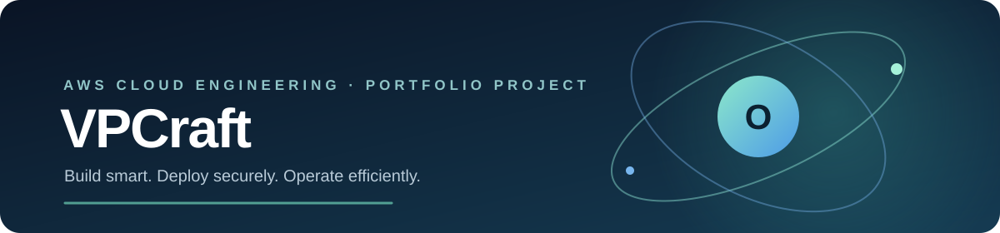
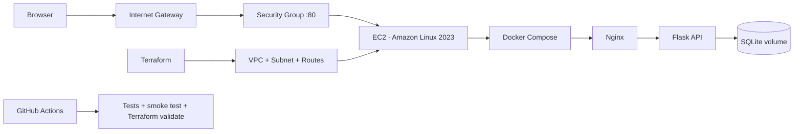

<div align="center">



# VPCraft
### Cost-Aware AWS Cloud Infrastructure Platform

**Build smart. Deploy securely. Operate efficiently.**

[](https://github.com/Jafar19Khan/vpcraft-cloud-platform/actions/workflows/ci.yml)
[](LICENSE)
[](https://www.python.org/)
[](https://developer.hashicorp.com/terraform)
[](https://docs.docker.com/compose/)

</div>

---

## Overview

VPCraft provisions a small, secure AWS environment with **Terraform** and deploys a three-tier web application on it: **Nginx** (presentation), a **Flask** API (application) and **SQLite** (data), all running in containers on one EC2 instance. A live operations dashboard shows service health, host CPU / memory / disk, database latency and platform events.

The design is deliberately lean: no NAT Gateway, load balancer, EKS or managed database, which keeps cost and operational surface small. Cost guardrails are documented in [`docs/free-tier-and-costs.md`](docs/free-tier-and-costs.md).

## Highlights

- **Infrastructure as Code**: custom VPC, public subnet, Internet Gateway, route table, security group, IAM role and instance profile, and EC2, all in Terraform.
- **Secure by default**: no inbound SSH (SSM Session Manager), IMDSv2 required, encrypted EBS, HTTP-only security group with configurable source CIDRs.
- **Hardened containers**: non-root user, read-only root filesystem, all capabilities dropped, `no-new-privileges`, health checks and log rotation.
- **Hardened edge**: Nginx with Content-Security-Policy, security headers, gzip and API rate limiting.
- **CI quality gates**: unit tests, a full container smoke test and Terraform format / validate on every push.
- **Observable**: `/health` vs `/ready`, live host metrics and stored latency samples on the dashboard.

## Architecture



Full diagram and design decisions: [`docs/architecture.md`](docs/architecture.md).

## Technology stack

| Area | Technology |
|---|---|
| Cloud | AWS EC2, VPC, EBS, Security Groups, IAM, Systems Manager |
| Infrastructure as Code | Terraform |
| OS | Amazon Linux 2023 |
| Containers | Docker, Docker Compose |
| Edge | Nginx 1.28 |
| Application | Python 3.12, Flask, Gunicorn |
| Data | SQLite on a persistent Docker volume |
| CI | GitHub Actions |
| Quality | Python unittest, Terraform fmt / validate, container smoke test |

## Repository layout

```text
vpcraft-cloud-platform/
├── .github/            # CI workflow, Dependabot, issue and PR templates
├── app/                # Flask API, health endpoints, host metrics
├── web/                # Dashboard (HTML, CSS, JS)
├── nginx/              # Nginx reverse-proxy configuration
├── infra/              # Terraform for AWS
├── docs/               # Architecture, cost guide, evidence checklist
├── scripts/            # Local verification helper
├── tests/              # Automated tests
├── compose.yaml
├── Dockerfile
└── Makefile
```

## Run locally

Prerequisites: Git, Python 3.12+, Docker with the Compose plugin (optional).

**With Python**

```bash
git clone https://github.com/Jafar19Khan/vpcraft-cloud-platform.git
cd vpcraft-cloud-platform
python -m venv .venv
source .venv/bin/activate        # Windows PowerShell: .\.venv\Scripts\Activate.ps1
pip install -r requirements.txt
python -m unittest discover -s tests -v
gunicorn --bind 127.0.0.1:8000 app.wsgi:app
```

Open `http://127.0.0.1:8000`.

**With Docker Compose**

```bash
cp .env.example .env
docker compose up --build -d
docker compose ps
```

Open `http://localhost:8080`. Stop with `docker compose down` (add `-v` to also remove the data volume).

## Deploy to AWS

> AWS Free Tier eligibility depends on account creation date, plan, region and instance type. Read [`docs/free-tier-and-costs.md`](docs/free-tier-and-costs.md) first. This project does not guarantee zero charges.

```bash
aws sts get-caller-identity                 # confirm account and credentials
cd infra
cp terraform.tfvars.example terraform.tfvars
terraform fmt -recursive
terraform init
terraform validate
terraform plan -out=tfplan
terraform apply tfplan
```

Terraform prints `application_url`. First boot takes a few minutes while the instance installs Docker, clones this repository and builds the containers.

Verify:

```bash
curl http://<public-ip>/health
curl http://<public-ip>/ready
curl http://<public-ip>/api/status
```

Open a shell without SSH (command also printed as the `ssm_session_command` output):

```bash
aws ssm start-session --target <instance-id> --region ap-south-1
sudo docker compose -f /opt/vpcraft/compose.yaml ps
sudo tail -n 100 /var/log/vpcraft-bootstrap.log
```

Tear down when finished:

```bash
terraform destroy
```

## Terraform variables

| Variable | Default | Purpose |
|---|---|---|
| `aws_region` | `ap-south-1` | AWS region |
| `environment` | `demo` | Environment label and resource tag |
| `vpc_cidr` | `10.42.0.0/16` | VPC address range |
| `public_subnet_cidr` | `10.42.1.0/24` | Public subnet range |
| `instance_type` | `t3.small` | EC2 instance type |
| `allowed_http_cidrs` | `["0.0.0.0/0"]` | Source ranges allowed on port 80 |
| `github_repo_url` | this repository | Public clone URL used at first boot |

## API

| Endpoint | Purpose |
|---|---|
| `GET /` | Operations dashboard |
| `GET /health` | Process health |
| `GET /ready` | Application and database readiness |
| `GET /api/overview` | Platform, instance metadata and recent events |
| `GET /api/system` | CPU load, memory, disk and uptime |
| `GET /api/status` | Database latency samples and statistics |

## Security notes

- No inbound SSH rule; administration uses Systems Manager Session Manager.
- IMDSv2 is required; the root EBS volume is encrypted and removed on termination.
- Only Nginx is public. The API is reachable only on the internal Compose network.
- Credentials, `.env`, Terraform state and `.tfvars` files are git-ignored.
- The demo serves HTTP. Add a domain, TLS and a managed database before handling real data. See [`SECURITY.md`](SECURITY.md).

## Roadmap

- [ ] HTTPS with a domain and ACM certificate
- [ ] Optional managed database with an explicit cost estimate
- [ ] Container image publishing and release workflow
- [ ] CloudWatch metrics and alarms

## Contributing

See [`CONTRIBUTING.md`](CONTRIBUTING.md). Document every new AWS resource and its cost implications.

## License

MIT for original project material. Third-party components keep their own licenses; see [`THIRD_PARTY_NOTICES.md`](THIRD_PARTY_NOTICES.md).
