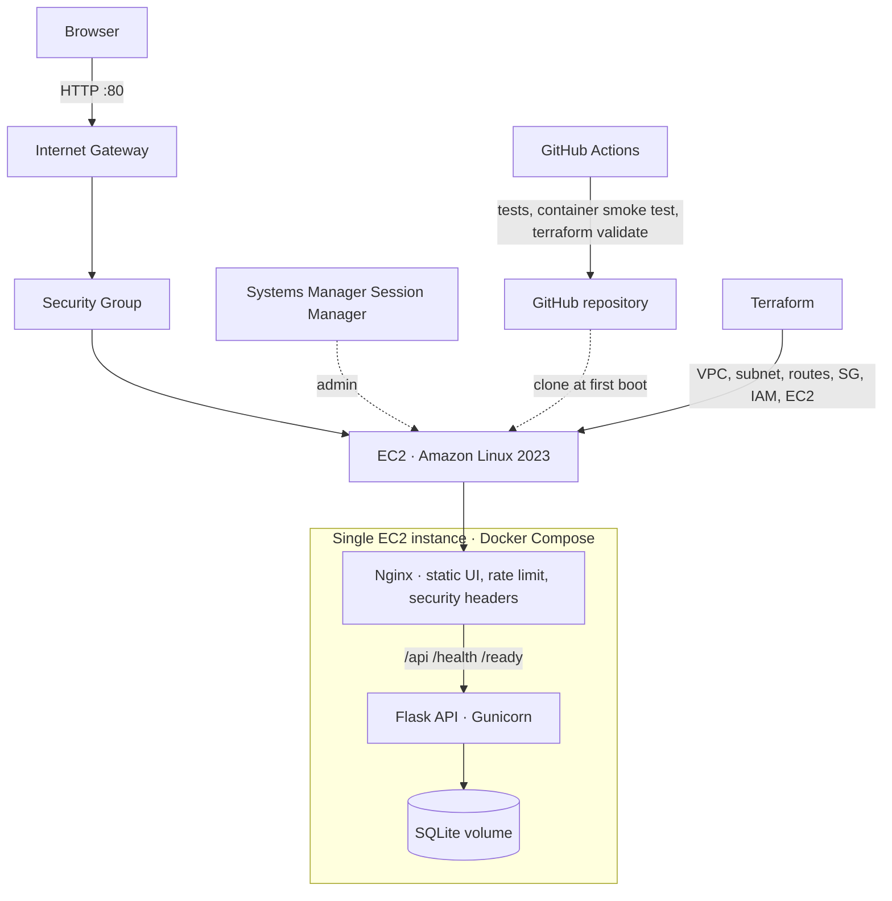

# Architecture

## Deployment view

## Design decisions

- **Three logical tiers on one host.** Nginx (presentation), Flask API (application) and SQLite (data) keep the footprint small and the cost predictable.
- **Only Nginx is public.** The API is on the internal Compose network and is reached through Nginx.
- **No inbound SSH.** Administration uses SSM Session Manager through an instance profile with `AmazonSSMManagedInstanceCore`.
- **IMDSv2 required.** The bootstrap script reads instance metadata with a session token and passes it to the app as environment variables, so containers never need metadata access (hop limit stays 1).
- **Dedicated VPC, one public subnet, Internet Gateway.** No NAT Gateway, load balancer, VPC endpoints or managed database.
- **Encrypted 8 GiB gp3 root volume**, deleted on termination.
- **Hardened containers.** Non-root user, read-only root filesystem, all Linux capabilities dropped, `no-new-privileges`, log rotation.
- **Nginx hardening.** Content-Security-Policy, request rate limiting on `/api/`, gzip, security headers.
- **Health vs readiness.** `/health` reports the process; `/ready` also verifies the database.
- **CI without cloud credentials.** GitHub Actions runs unit tests, a full container smoke test and Terraform format/validate. Deployment is a deliberate manual `terraform apply`.

## Limits

SQLite on a single host suits a demonstration, not a horizontally scaled production workload. HTTP is unencrypted; add a domain, TLS and a managed data tier before real traffic.

## Possible next stages

HTTPS with ACM and a load balancer, RDS, multi-AZ networking, container registry, CloudWatch metrics and alarms. Estimate the cost of each stage before provisioning.
